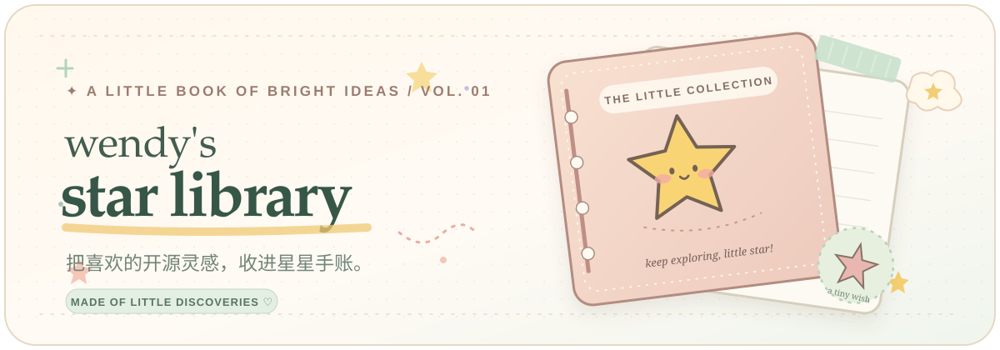
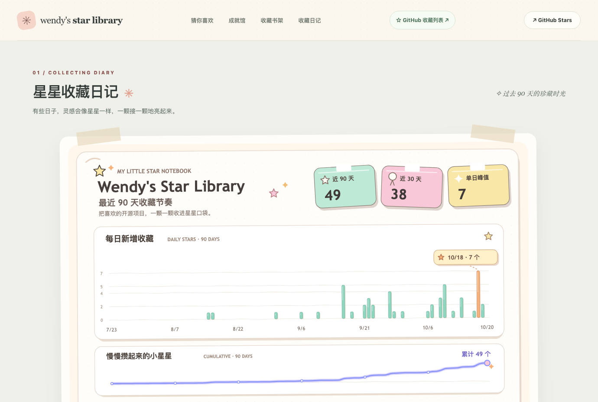

  

   

  **✦ 把喜欢的开源灵感，收进星星手账。✦**

  有些灵感只是一闪而过，有些却值得好好收藏。 
  这里是我的小小开源收藏馆：把 GitHub 上遇见的宝藏，整理成一本会慢慢长大的手账。

   

  **[🌷 翻开星星收藏馆 · OPEN THE LIBRARY ↗](https://wendyltan.github.io/star-library/)**

  [我的 GitHub Stars](https://github.com/wendyltan?tab=stars) · [看看成就图鉴](https://wendyltan.github.io/star-library/#badges) · [发现新的宝藏](https://wendyltan.github.io/star-library/#discover)

  ✳ A PERSONAL COLLECTION OF BRIGHT LITTLE IDEAS · CURATED WITH CURIOSITY

---

### ✿ 先翻开一页，看看里面长什么样

  
   
  ↑ 点击图片，进入真正的收藏馆。截图记录的是制作时的模样，收藏数据会继续更新。

 

### ✧ 这本小手账里，藏着什么？

| 🌷 星星收藏日记 | 🧺 彩色灵感书架 |
| :--- | :--- |
| 用手绘感的 90 天趋势图，记住每次点亮星星的小日子。 | 把收藏放进不同主题的抽屉；搜索、筛选、排序，让宝藏不再吃灰。 |

| 🍮 猜你喜欢 | 🎀 星星成就馆 |
| :--- | :--- |
| 按兴趣寻找还没收藏的好项目，附上可验证的 GitHub 近期热度。 | **42 枚原创手绘贴纸徽章**，记录主题探索、专精、作者缘分与成长轨迹。 |

 

### ♡ 最喜欢的，是这些自己画的小勋章

  
  &nbsp;
  
  &nbsp;
  
  &nbsp;
  
  &nbsp;
  

  ✦ 收藏里程碑　·　分类探索　·　技术专精　·　作者缘分　·　探索足迹 ✦

   

  每一枚都有自己的颜色、表情和小故事。 
  不是为了刷数量，而是认真记住「原来我又发现了这么多有趣的东西」。

  **已经获得的徽章会被永久珍藏。** 哪怕后来整理了旧收藏，也不会丢掉这份纪念。

  [去逛整本徽章图鉴 ↗](https://wendyltan.github.io/star-library/#badges)

---

### ☁️ 一点点魔法，藏在背后

> **收藏是真的，热度是真的，星星也由自己亲手点亮。**

- **GitHub Stars → 收藏手账**：后台大约每 15 分钟整理一次收藏数据，保留已经仔细分过类的项目。
- **每周小发现**：根据兴趣和可核实的 GitHub 近期数据，定期推荐新工具。
- **每天收好小成就**：42 枚徽章会更新进度，已经解锁的纪念不会撤销。
- **约每小时刷新展览**：网页从经过筛选的静态内容重新生成；GitHub Actions 调度可能会稍有延迟。
- **收藏交给 GitHub**：点击手账里的星星或推荐卡的「去 GitHub 收藏」，在新标签页打开官方仓库。是否点 Star，永远由你决定。

 

  ✳ 小小的公开说明

  这个仓库的 `main` 分支放着欢迎页和展示素材； 
  `gh-pages` 分支存放自动生成的公开静态网站。

  网站只展示经过筛选、允许公开的收藏内容。 
  私有自动化源码、访问令牌、Gist 原始数据及内部复核记录都不会在这里发布。

   

  **[✨ 再去看看星星收藏馆](https://wendyltan.github.io/star-library/)**

  made with care · keep exploring · 2026 ♡

